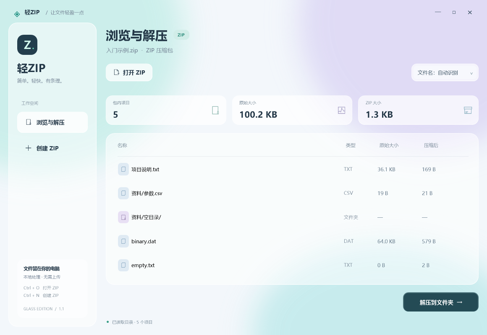
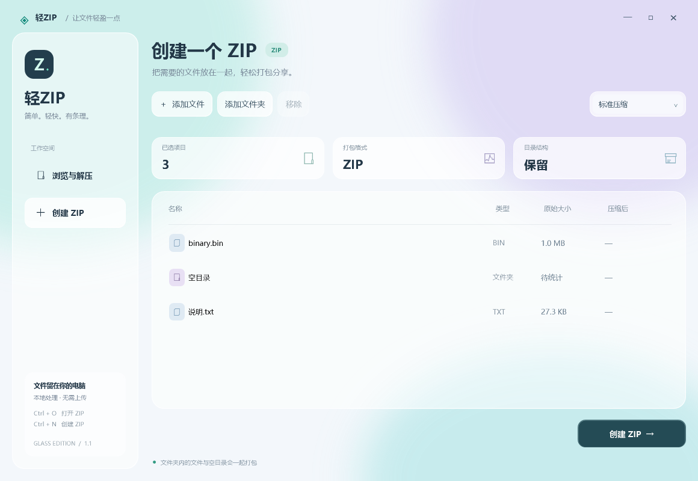

<div align="center">

# 轻ZIP · QingZip

轻快的 Windows ZIP 压缩与解压工具，搭配毛玻璃界面与柔和动效。

[](https://github.com/YSJ-LXC/QingZip/releases/latest)
[](https://github.com/YSJ-LXC/QingZip/releases/latest)
[](https://github.com/YSJ-LXC/QingZip/actions/workflows/build.yml)
[](LICENSE)

[下载最新版](https://github.com/YSJ-LXC/QingZip/releases/latest) · [使用说明](docs/usage.md) · [更新记录](CHANGELOG.md) · [反馈问题](https://github.com/YSJ-LXC/QingZip/issues)



</div>

## 功能

- 浏览 ZIP 内的文件名、类型、原始大小与压缩后大小。
- 将整个压缩包解压到新的文件夹，名称冲突时自动编号。
- 添加文件、文件夹或直接拖入窗口，创建标准压缩 ZIP 或仅打包 ZIP。
- 支持 UTF-8、旧 GBK/CP437 文件名，以及 ZIP64 目录字段。
- 后台处理任务、平滑进度和取消操作；完成后可打开结果。
- 毛玻璃叠层、薄荷绿与淡紫柔光、圆角卡片、页面滑入和按钮悬停动效。
- 文件在本机处理，无需上传到服务器。



## 下载与运行

在 [Releases](https://github.com/YSJ-LXC/QingZip/releases/latest) 下载 `QingZip-v1.1.0-windows-portable.zip`，解压后双击 `QingZip.exe`。请保留同目录的 `QingZip.exe.config`。

运行环境：Windows 10 / 11、.NET Framework 4.8。支持的 Windows 11 系统会请求原生 Desktop Acrylic 材质；其他环境使用柔光渐变与半透明面板。静态截图仅展示程序界面，打开软件即可体验动效。

当前支持未加密 ZIP 的 Stored / Deflate 方法，每次最多处理 4 GB 原始数据与 100,000 个条目。暂不支持 RAR、7z、密码包、分卷和自解压 EXE。

## 构建

不需要额外的界面依赖或 NuGet 包。使用 Windows 自带的 .NET Framework 编译器：

```bat
BUILD.cmd
bin\QingZip.exe
```

也可以用 Visual Studio / MSBuild 打开 `src/QingZip.csproj`，需要 .NET Framework 4.8 targeting pack。

## 测试

```bat
tests\RUN_TESTS.cmd
tests\RUN_UI_TESTS.cmd
```

核心测试需要 Python 3；26 项通用测试覆盖编码、ZIP64、CRC、异常路径、取消和输出保护。默认位置安装了 WinRAR 时，还会执行 2 项双向兼容性测试。界面测试不需要 Python；启用系统动画时包含悬停动效检查，最多 14 项。测试使用独立的工作目录。

## 项目结构

```text
src/       C# 窗口、XAML 样式与 ZIP 核心
tests/     独立格式验证与界面检查
docs/      使用说明、设计说明与截图
samples/   示例 ZIP
BUILD.cmd  构建入口
```

`ArchiveEngine.cs` 负责 ZIP 目录解析、路径检查、CRC32 复核和分阶段输出；压缩数据交由 .NET ZIP / Deflate 库处理。`MainView.xaml` 定义界面，`Main.cs` 管理交互与后台任务。实现依据公开 ZIP 格式，没有包含 WinRAR 程序、资源或反编译代码。

## 贡献与许可

欢迎通过 Issue 提交复现步骤，或通过 Pull Request 改进软件。开发步骤见 [CONTRIBUTING.md](CONTRIBUTING.md)。源码采用 [MIT License](LICENSE)。
